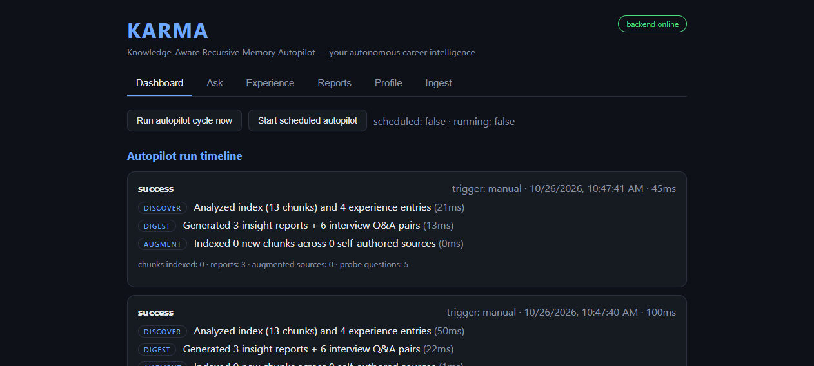
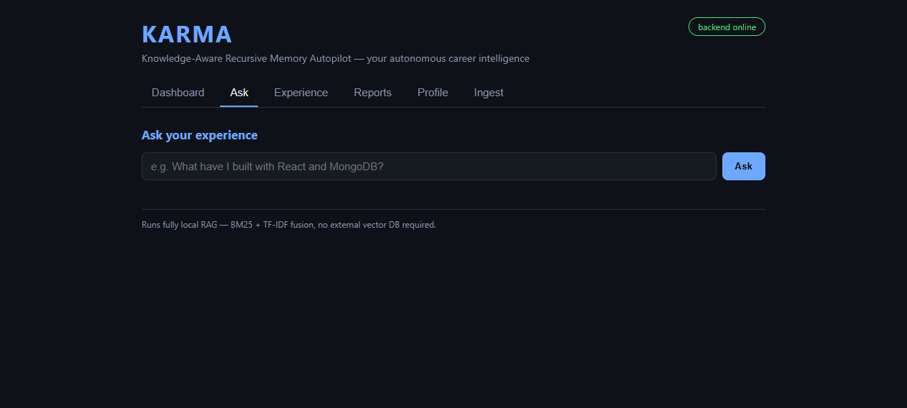
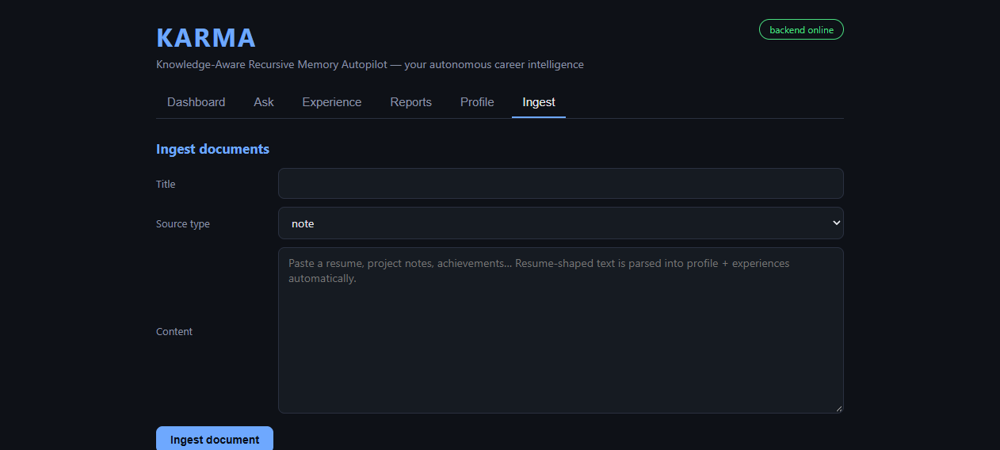
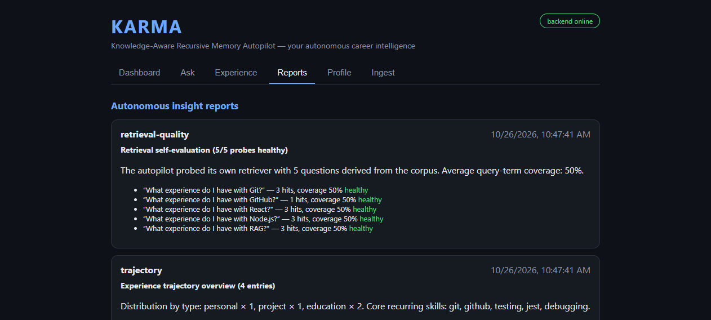
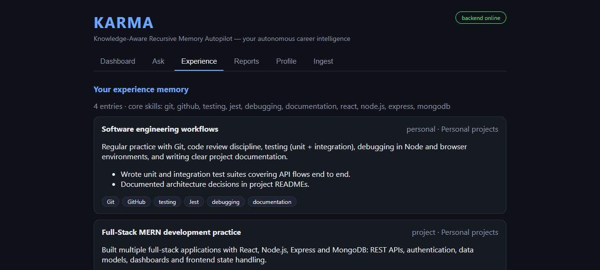
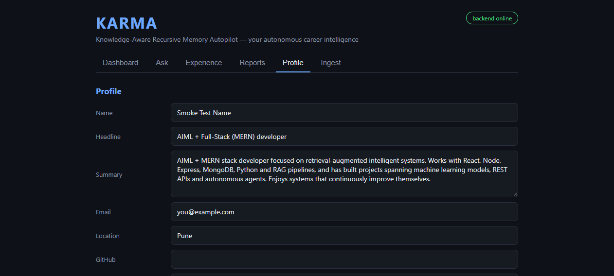

# KARMA — Knowledge-Aware Recursive Memory Autopilot

An **autonomous career-intelligence platform**: you feed it your entire experience
(resume, projects, notes, achievements) once — KARMA ingests it, builds a retrieval-augmented
memory, then runs itself on autopilot: continuously generating insight reports, self-evaluating
retrieval quality, enriching its own index, and answering natural-language questions with
cited sources from *your* experience.

Built from scratch on purpose — **no LangChain, no external vector DB**, no paid API required
(optional OpenAI-compatible LLM uplift for grounded answer synthesis, works with Groq / OpenAI / any compatible endpoint).

| Layer | What it does | Tech |
|---|---|---|
| RAG engine | Structural chunking → TF-IDF/BM25 hybrid retrieval → reciprocal-rank fusion → deterministic reranking → cited, hallucination-resistant answer synthesis | Pure Node.js |
| Autopilot agent | DDA loop (Discover → Digest → Augment): scheduled self-runs, autonomous insight generation, retrieval-quality self-evaluation, in-place index self-enrichment (no duplicate bloat) | node-cron |
| AIML analytics | Skill-gap analysis vs a target capability profile, experience trajectory analytics, retrieval-quality probes | Pure Node.js |
| MERN | MongoDB (Mongoose) + Express REST API + React dashboard (profile editor, document ingestion with resume auto-parsing, ask UI, reports, autopilot controls) | Full stack |

| Dashboard | Ask | Ingest |
|---|---|---|
|  |  |  |

| Reports | Experience | Profile |
|---|---|---|
|  |  |  |

## Highlights

- **From-scratch hybrid retrieval**: BM25 (lexical) + TF-IDF cosine (semantic) fused with
  reciprocal rank fusion, then a deterministic reranker (term coverage, heading relevance,
  source-type weights, length/freshness priors). Fitted engines are cached and invalidated
  by a corpus-version counter — no per-query rebuilds.
- **Cited answers, anti-hallucination by construction**: answers may come from the local
  extractive synthesizer or an LLM, but both are grounded in retrieved chunks; inline `[n]`
  citations always map to the listed sources.
- **Self-improving agent**: each cycle finds gaps (uncovered skills, weak retrieval probes,
  unindexed experiences), writes skill-gap / trajectory / retrieval-quality reports, and
  augments its own index — idempotently, dedupe-checked so scheduled runs never bloat it.
- **Tested**: 103 backend tests (Jest, unit + integration over in-memory MongoDB) and
  26 frontend tests (Vitest + React Testing Library), plus a production build check.

## Quick start

```bash
# 1) backend
cd backend
npm install
npm run dev          # API on http://localhost:5001

# 2) frontend (new terminal)
cd frontend
npm install
npm run dev          # dashboard on http://localhost:5173
```

### MongoDB

Set `MONGODB_URI` (default `mongodb://127.0.0.1:27017/karma`) in `backend/.env`.

- Don't have MongoDB installed locally? Set `KARMA_IN_MEMORY_DB=1` in `backend/.env`
  and the backend will start its own temporary in-memory MongoDB instance (same engine
  used for tests) — the full stack runs with zero local installs.

### Optional LLM uplift (Groq / OpenAI-compatible)

The RAG engine runs fully local by default. To get LLM-written grounded answers, put any
OpenAI-compatible endpoint into `backend/.env` (`OPENAI_API_KEY`, `OPENAI_BASE_URL`,
`OPENAI_MODEL`) — e.g. Groq:

```env
OPENAI_API_KEY=gsk_...
OPENAI_BASE_URL=https://api.groq.com/openai/v1
OPENAI_MODEL=openai/gpt-oss-120b
```

The `/api/ask` response reports `llmUsed: true` and `mode: "llm"` when the uplift is active;
failures fall back to the local extractive answer automatically.

## Deployment (Vercel + MongoDB Atlas)

Both services deploy as separate Vercel projects:

**1) Backend** (`karma/backend`):
- Create a free MongoDB Atlas cluster and copy the connection string.
- Import the project into Vercel (root = `backend`); `vercel.json` and `api/index.js`
  are preconfigured serverless entrypoints.
- Environment variables: `MONGODB_URI` (Atlas URI — required for persistent data),
  optional `OPENAI_API_KEY` / `OPENAI_BASE_URL` / `OPENAI_MODEL`.
  Without `MONGODB_URI` the API runs in per-instance in-memory demo mode (data resets).
- Note: scheduled autopilot requires a long-running process — use local/scheduled hosting
  for cron; serverless deployments run cycles on demand via the dashboard/API.

**2) Frontend** (`karma/frontend`):
- Import into Vercel (root = `frontend`) — it builds with Vite automatically.
- Environment variable: `VITE_API_BASE_URL=https://<your-backend>.vercel.app/api`
  (set it after the backend deployment is live).

## Autonomous baseline data

On first boot with an empty database, KARMA seeds itself with a starter experience
profile (configurable in `backend/src/data/seedExperience.js`). Replace it with *your*
real resume/projects/notes — or simply paste your resume through the dashboard's
**Ingest** tab: resume-shaped text is parsed into profile + experiences and indexed
automatically (idempotent — re-committing the same resume does not duplicate entries).

## Testing

```bash
cd backend && npm test              # unit + integration tests (Jest, in-memory MongoDB;
                                    # first run downloads the temporary MongoDB binary once)
cd frontend && npm test             # unit + component tests (Vitest)
cd frontend && npm run test:build   # production build check (vite build)
```

## API overview

| Route | Purpose |
|---|---|
| `GET /api/health` | Liveness + db + autopilot status |
| `GET /api/profile` / `POST/PUT /api/profile` | Personal profile (partial updates never wipe stored fields) |
| `POST /api/profile/parse` | Raw resume → structured profile + experiences (preview) |
| `POST /api/profile/parse/commit` | Persist parsed resume (deduped; 409 on re-commit, 422 if nothing parses) |
| `POST /api/documents` | Ingest raw text (title, source, content) → chunked + embedded |
| `GET /api/documents` / `DELETE /api/documents/:id` | List/remove ingested sources (auto deindex) |
| `POST /api/ask` | RAG query → cited answer (local extractive or LLM-grounded) |
| `GET /api/experience` | Structured experience timeline + analytics |
| `GET /api/reports` | Autonomously generated insight reports (`?kind=` filter) |
| `GET /api/runs` | Autopilot run history (per-phase steps, timings, stats) |
| `POST /api/agent/autopilot/start` / `.../stop` | Control the scheduled autopilot |
| `POST /api/agent/run` | Trigger one autopilot cycle on demand |
| `GET /api/agent/status` | Scheduler state |

## Architecture notes

- The corpus and fitted retrieval engines live behind a version counter
  (`ragIndex.getCorpus()`): indexing operations bump the version, every consumer's cache
  is invalidated automatically.
- Chunking preserves headings and list structure with controlled overlap; the final
  remainder is merged (never silently dropped), and no chunk exceeds the size cap.
- Validation errors surface as HTTP 400s; unknown routes return structured JSON 404s.
