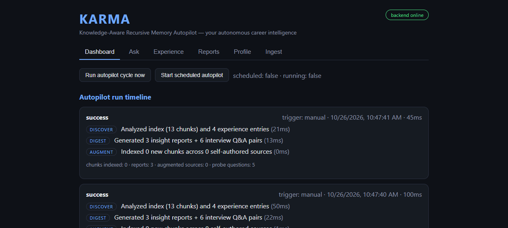
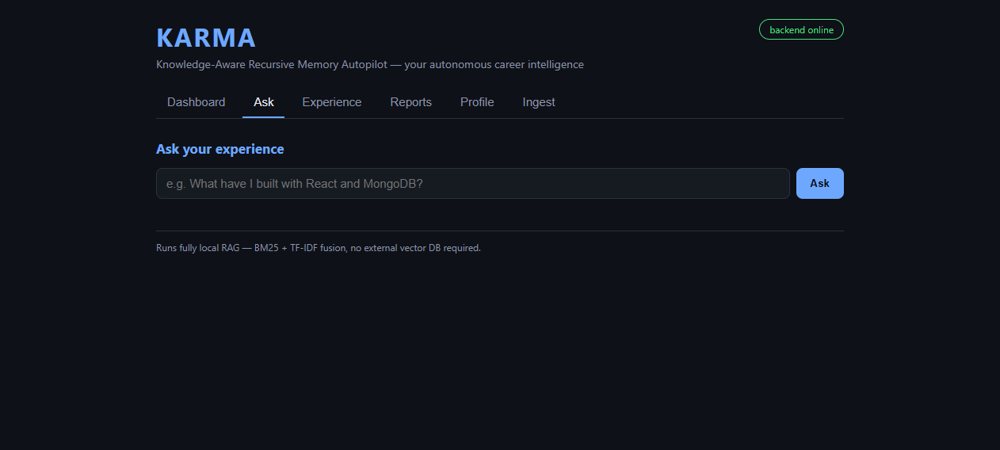
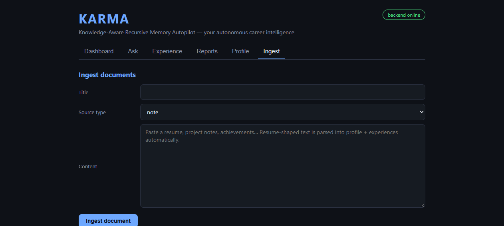

# KARMA — Knowledge-Aware Recursive Memory Autopilot

An **autonomous career-intelligence platform**: you feed it your entire experience
(resume, projects, notes, achievements) once — KARMA ingests it, builds a retrieval-augmented
memory, then runs itself on autopilot: continuously generating insight reports, self-evaluating
retrieval quality, enriching its own index, and answering natural-language questions with
cited sources from *your* experience.

**Stack: Python · FastAPI · RAG · Qdrant · GPT-4o · Gemini** — the RAG engine is built
from scratch (no LangChain); the vector side runs on Qdrant, the lexical side on a
hand-written Okapi BM25, and rank fusion/recall on scikit-learn TF-IDF.

| Layer | What it does | Tech |
|---|---|---|
| RAG engine | Structural chunking → hybrid **BM25 + TF-IDF (scikit-learn)** retrieval with weighted **reciprocal-rank fusion** → **Qdrant** vector search → **GPT-4o / Gemini** reranking → cited, hallucination-resistant answer synthesis | Python, FastAPI |
| Autopilot agent | DDA loop (Discover → Digest → Augment): cron-driven self-runs, autonomous insight generation, retrieval-quality self-evaluation, in-place index self-enrichment (no duplicate bloat) | APScheduler |
| AIML analytics | Skill-gap analysis vs a target capability profile, experience trajectory analytics, **Pandas/NumPy retrieval evaluation** (precision@k, recall@k, MRR, nDCG) | Pandas, NumPy, scikit-learn |
| Infra | MongoDB (Motor) persistence, Redis answer caching with corpus-version invalidation, embedded fallbacks so it runs with zero installs, Docker Compose for the full stack | Docker, Redis, MongoDB |

| Dashboard | Ask | Ingest |
|---|---|---|
|  |  |  |

## Quick start (zero installs)

```bash
cd backend
python -m venv .venv
.venv\Scripts\pip install -r requirements.txt      # Linux/macOS: .venv/bin/pip ...
.venv\Scripts\python server.py                     # API on http://localhost:5001

# frontend (new terminal)
cd frontend
npm install
npm run dev                                        # dashboard on http://localhost:5173
```

Without MongoDB/Qdrant/Redis running, the API automatically uses embedded fallbacks
(in-memory demo database, in-process Qdrant, in-process cache) — the full stack runs
with zero local services. Set `MONGODB_URI` in `backend/.env` for persistent memory.

## Docker Compose (full stack)

```bash
docker compose up --build
# dashboard: http://localhost:8080   API: http://localhost:5001/api/health
```

Provisions MongoDB, Qdrant, Redis, the FastAPI backend and the dashboard. LLM keys
can come from `backend/.env` or environment variables.

## Highlights

- **Hybrid retrieval, from scratch**: Okapi BM25 (k1=1.5, b=0.75) fused with
  scikit-learn TF-IDF cosine via weighted reciprocal rank fusion (0.7/0.3), then a
  deterministic reranker (term coverage, heading relevance, source-type weights,
  length/freshness priors). Fitted engines are cached per corpus version — no
  per-query rebuilds.
- **Qdrant vector search**: chunk embeddings live in a Qdrant collection (sparse
  TF-IDF vectors), re-synced on every index change; degrades gracefully to in-process
  cosine when Qdrant is unavailable.
- **GPT-4o + Gemini uplift**: LLM reranking of the fused pool plus grounded answer
  synthesis with inline `[n]` citations that always map to the listed sources. Any
  failure silently falls back to the local extractive pipeline — never fatal.
- **Self-improving agent**: each cycle finds gaps (uncovered skills, weak retrieval
  probes, unindexed experiences), writes skill-gap / trajectory / retrieval-quality
  reports, and augments its own index — idempotently, dedupe-checked so scheduled
  runs never bloat it.
- **Measured retrieval quality**: a Pandas/NumPy evaluator probes the retriever with
  corpus-derived questions and reports precision@k, recall@k, MRR and nDCG
  (`GET /api/evaluation`).
- **Tested**: 103 backend tests (pytest, unit + integration over an in-memory
  MongoDB) and 26 frontend tests (Vitest + React Testing Library) — 129 total —
  plus a production build check.

## Configuration (`backend/.env`)

```env
MONGODB_URI=mongodb://127.0.0.1:27017/karma   # or a MongoDB Atlas URI
QDRANT_URL=                                   # empty → embedded in-memory Qdrant
REDIS_URL=                                    # empty → in-process cache fallback
KARMA_AUTOPILOT_ENABLED=false
KARMA_AUTOPILOT_CRON=*/15 * * * *             # APScheduler cron
OPENAI_API_KEY=                               # GPT-4o / OpenAI-compatible (Groq, etc.)
OPENAI_MODEL=gpt-4o
GEMINI_API_KEY=                               # Google Gemini uplift
GEMINI_MODEL=gemini-2.0-flash
```

The `/api/ask` response reports `llmUsed: true` and `metrics.mode: "llm"` when the
uplift is active, plus `metrics.rerankedBy` (`heuristic`, `openai` or `gemini`).

## Autonomous baseline data

On first boot with an empty database, KARMA seeds itself with a starter experience
profile (configurable in `backend/app/data/seed_experience.py`). Replace it with
*your* real resume/projects/notes — or simply paste your resume through the dashboard's
**Ingest** tab: resume-shaped text is parsed into profile + experiences and indexed
automatically (idempotent — re-committing the same resume does not duplicate entries).

## Testing

```bash
cd backend && .venv\Scripts\python -m pytest tests -q      # 103 tests (in-memory MongoDB)
cd frontend && npm test                                    # 26 tests (Vitest)
cd frontend && npm run test:build                          # production build check
```

## API overview

| Route | Purpose |
|---|---|
| `GET /api/health` | Liveness + db + autopilot status |
| `GET /api/profile` / `POST/PUT /api/profile` | Personal profile (partial updates never wipe stored fields) |
| `POST /api/profile/parse` | Raw resume → structured profile + experiences (preview) |
| `POST /api/profile/parse/commit` | Persist parsed resume (deduped; 409 on re-commit, 422 if nothing parses) |
| `POST /api/documents` | Ingest raw text (title, source, content) → chunked + embedded |
| `GET /api/documents` / `DELETE /api/documents/:id` | List/remove ingested sources (auto deindex) |
| `POST /api/ask` | RAG query → cited answer (local extractive or LLM-grounded) |
| `GET /api/experience` | Structured experience timeline + analytics |
| `GET /api/reports` | Autonomously generated insight reports (`?kind=` filter) |
| `GET /api/evaluation` | Pandas/NumPy retrieval metrics (precision@k, recall@k, MRR, nDCG) |
| `GET /api/runs` | Autopilot run history (per-phase steps, timings, stats) |
| `POST /api/agent/autopilot/start` / `.../stop` | Control the APScheduler autopilot |
| `POST /api/agent/run` | Trigger one autopilot cycle on demand |
| `GET /api/agent/status` | Scheduler state |

## Architecture notes

- The corpus and fitted retrieval engines live behind a version counter
  (`rag_index.corpus_version`): indexing operations bump the version, every consumer's
  cache (corpus list, BM25/TF-IDF fit, Qdrant collection, Redis answer cache) is
  invalidated automatically.
- Chunking preserves headings and list structure with controlled overlap; the final
  remainder is merged (never silently dropped), and no chunk exceeds the size cap.
- Validation errors surface as HTTP 400s; unknown routes return structured JSON 404s.
- Deployment: any host that runs Docker (or a long-running Python process) works —
  `docker compose up --build` is the reference deployment.
